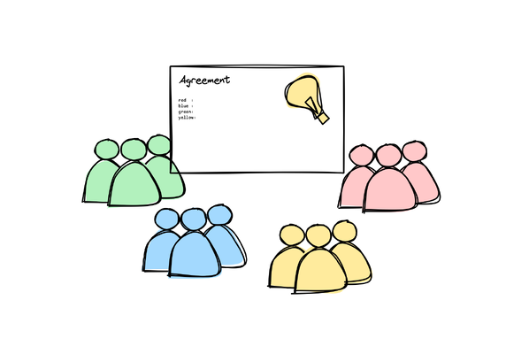
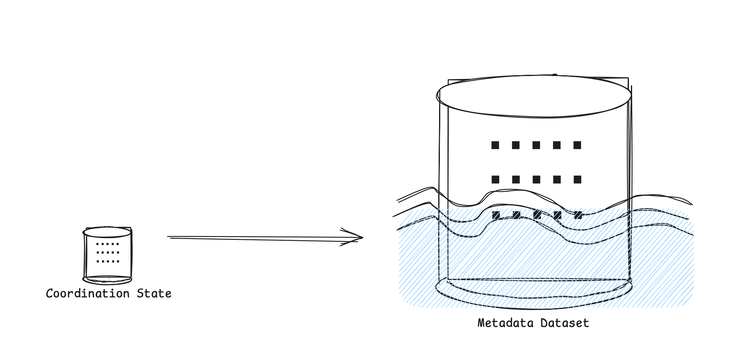
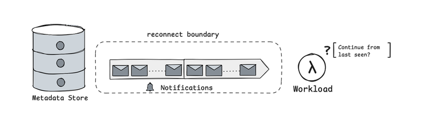
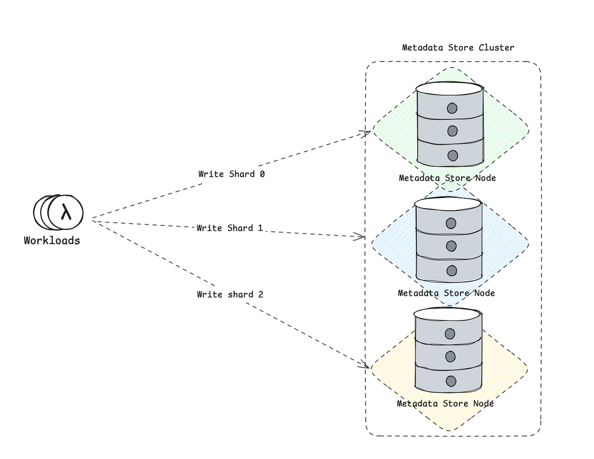
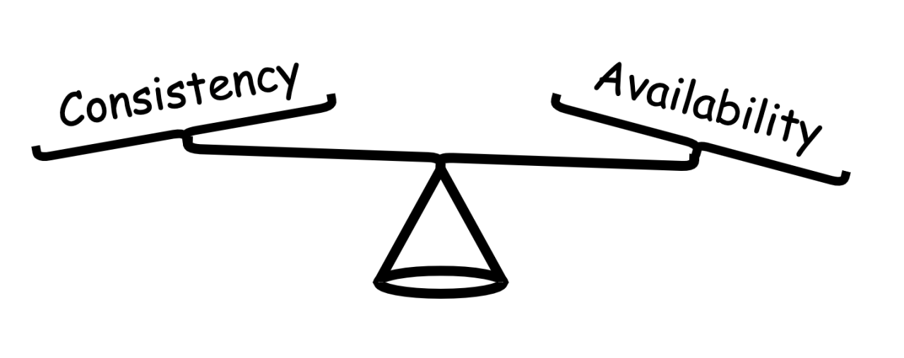
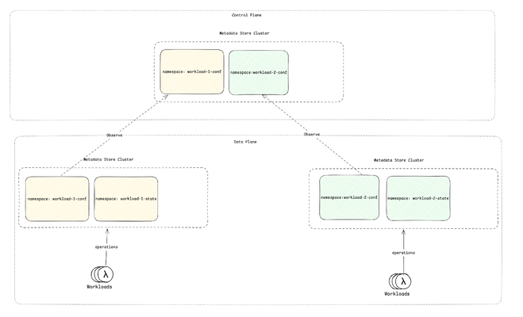
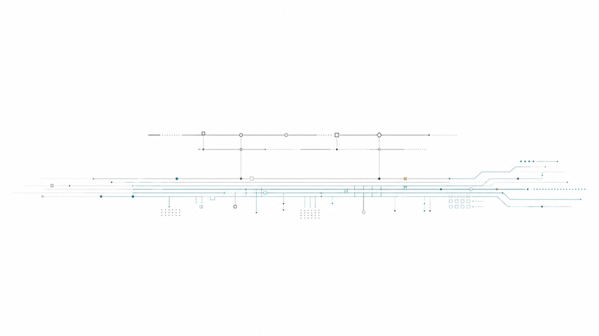
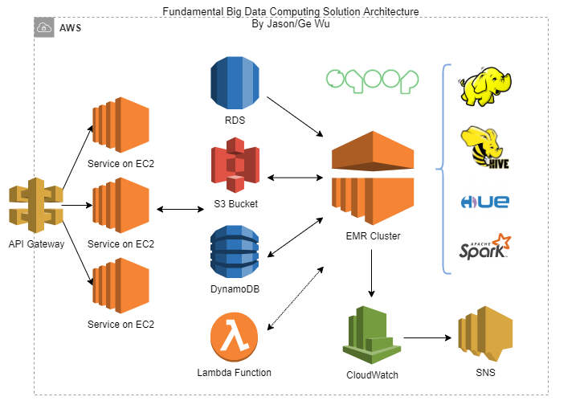

# From Metadata Store to Metadata Plane

### Metadata Started as Coordination State

*Metadata began as small shared truth: leader, lease, ownership, membership, and configuration.*

Distributed systems have always needed a place to keep a small amount of authoritative state.

Which node is the leader? Which worker owns a shard? Which server may accept writes? Which configuration version is current? Which member is still alive?

That state was never ordinary data. It was usually small, but other components treated it as authority. A stale read or a lost update could send traffic to the wrong node, elect two owners for the same work, or let a writer proceed under an old configuration.

That is why the metadata systems are designed around correctness first. They needed consistent updates, conditional writes, ordering, failure detection, sessions, and watches. They did not need rich query engines or high-volume storage paths. The data was small enough that size was not the hard problem. Agreement was the hard problem.

That model still matters. Many systems still need a compact coordination core. But the workload around metadata has changed. The same state that once coordinated a small group of processes is now read by fleets of clients, cached by proxies, watched by controllers, scanned by operators, and updated as part of normal operation.

In modern infrastructure systems, especially streaming systems, metadata is no longer only coordination state. It is also operational state: stream state, cursor state, segment state, schemas, policies, placement decisions, ownership records, and lifecycle markers. The system still needs coordination semantics, but it also needs to store and serve a growing body of metadata as a dataset.

### When Small Metadata Becomes a Dataset

*At scale, coordination state starts behaving like a metadata dataset.*

The first shift is volume.

Older coordination paths mostly tracked facts such as leaders, members, locks, and configuration versions. Modern systems keep much more: stream definitions, shard assignments, cursor positions, schema versions, policy attachments, placement rules, segment lifecycle, and tenant-level settings.

Each record may still be small. The collection is not. This is where the old line between coordination and storage starts to blur.

ZooKeeper was built around coordination data: small znodes, hierarchical names, versions, sessions, transaction logs, snapshots, and watches. It made distributed agreement usable. But the model assumes that the data being coordinated is relatively small, and that a watch can often act as an invalidation signal: something changed, so the client can reload the current value.

etcd kept the coordination role, but moved closer to a versioned metadata store. It exposes a flat key-value space with revisions, range queries, MVCC, historical reads until compaction, and watch history. That design fits a world where metadata is not just a few facts, but a changing body of operational state.

The question is no longer only:

"Can we update this state correctly?"

It also becomes:

"Can we store it, find it, compare it, watch it, replay it, compact it, and serve it under load?"

Once metadata reaches millions of objects, it behaves like a real dataset. It has hot keys and cold keys. It has locality. It has retention. It has churn. It has fanout. Operators need to scan it, compare it, repair it, and reason about its history.

At that point, treating metadata as a handful of coordination facts becomes misleading. The state is still correctness-sensitive, but it is also a storage workload.

### When Cache Invalidation Becomes Correctness

*The hard part is defining the reconnect boundary.*

Caching metadata is natural. Without caching, every routing decision, ownership check, and policy evaluation would have to hit the metadata store directly.

But once metadata is cached, invalidation becomes part of correctness.

A stale owner can send traffic to the wrong node. A missed policy update can allow an operation that should have been rejected. A reordered notification can briefly make old state look newer than current state. A watcher that reconnects without a way to recover its position may not know whether its local view is still valid.

This means metadata notifications cannot be treated as best-effort hints.

ZooKeeper shows the earlier model. The state is durable, but watches are lightweight. A watch is ordered with respect to the client's session, but it is a one-time notification rather than a replayable stream of changes. That works when a listener only needs to know that something changed and can cheaply reload the current state.

Large metadata workloads often need more than invalidation. Listeners need ordered updates and versions. It is fine if the listener itself is memory-based. The important question is what happens when the connection breaks. When the client reconnects, the system needs a clear answer: can the client continue from the last version it observed, or has the gap become too large?

etcd is closer to this model. A watcher can observe changes in revision order and resume from a known revision while that revision remains available. Once compaction removes old revisions, a slow watcher cannot continue from that point and must perform a full resync from a fresh snapshot.

That boundary matters. The notification path has to define the order in which changes are observed, the version a client has seen, how much history can be replayed after reconnect, and when a full resync is required.

In a small system, a full resync may be acceptable. In a large system, full resyncs are expensive and can create their own load spikes. The larger and more distributed the cache population becomes, the more the notification path starts to look like a durable change stream rather than a side channel.

### When Metadata Traffic Moves Into the Runtime Path

*Sharding Architecture Metadata Store*

The next shift is traffic.

Metadata operations are easy to underestimate because each operation is usually small: one lookup, one watch, one conditional update, one range scan. None of these looks expensive in isolation.

But almost everything reads metadata.

A client needs metadata to find where a stream lives. A worker needs metadata to know which shards it owns. A controller updates metadata when placement changes. A storage node updates segment state. An operator scans metadata to inspect or repair the system.

Streaming systems make this especially visible. Stream state, cursor state, subscription state, segment lifecycle, schemas, and policy attachments can all become metadata traffic.

The write side grows too. When metadata is only coordination state, writes are relatively rare: leader changes, membership changes, ownership transfers, and configuration updates. When metadata also stores operational state, writes become part of normal activity. Stream creation, cursor movement, segment sealing, policy updates, and placement changes can all produce metadata writes.

Traditional coordination systems are replicated, but replication does not remove the ordering bottleneck.

ZooKeeper and etcd both rely on a single active leader to order updates within a cluster. That is the right shape for correctness-sensitive coordination state, but it becomes a scaling pressure as metadata traffic grows.

Followers can help with reads, but the consistency tradeoff matters. ZooKeeper can serve reads from any server, which improves read availability and throughput, but those reads may be stale unless the client synchronizes first. etcd exposes the tradeoff more explicitly: a serializable range request can be served locally by a member, while the default linearizable range request reflects the current consensus of the cluster and pays the cost of coordination.

This is the central scaling tension. The metadata path wants read fanout, but the system still needs freshness, ordering, and correctness. The more metadata moves into the runtime path, the more often the system must choose between local reads that may be stale and coordinated reads that preserve stronger guarantees.

Sharding changes the unit of coordination.

Instead of forcing all metadata writes through one global ordering point, the system can split metadata into shards. Each shard still needs its own ordering and replication semantics, but different shards can make progress independently.

This lets the cluster use multiple nodes for writes. A node may own one set of metadata shards while another node owns a different set. Clients may be able to send requests to any node, but each write is still routed internally to the shard that owns the relevant metadata.

Sharding does not remove coordination. It scopes coordination.

That is the scaling benefit. The system no longer has one global metadata write path. It has many smaller correctness domains that can be placed, moved, balanced, and recovered independently.

The sharding model itself matters. If metadata has clear ownership boundaries, shards can be split, merged, moved, and rebalanced as the workload changes. A hot namespace can be separated from cold namespaces. Small shards can be merged to reduce overhead. A large shard can be split when write volume, watch fanout, or scan cost grows.

In that form, sharding is not just a partitioning trick. It becomes an operational capability. The metadata layout can change over time while preserving the ordering and consistency guarantees each shard needs.

Metadata traffic is no longer occasional control-plane activity. It is runtime traffic.

### When Metadata Needs Federated Namespaces

The next shift is federated namespaces.

As systems grow, they often end up with multiple metadata clusters. Different workloads may run in different regions, availability zones, isolation domains, or data-plane clusters.

If each cluster manages its own configuration independently, operations become messy. Policies drift. Quotas get updated in one place but not another. Placement rules become hard to audit. Operators lose a consistent view of how workloads should be configured.

A centralized control-plane metadata store helps with that. It gives the platform one place to manage configuration. The configuration can still be organized into separate namespaces for workloads, tenants, or isolation boundaries, but it is managed through the same control plane.

That improves operability, but it introduces a risk. If data-plane clusters depend on the centralized control-plane store for every runtime operation, the control plane becomes part of the data-plane availability path. A control-plane outage could affect workloads that already have enough local state to keep running.

Federation avoids that dependency.

A data-plane metadata store can observe selected namespaces from the control-plane metadata store. By observing a namespace, it follows configuration changes such as policy updates, quota changes, and placement hints.

At the same time, the data-plane metadata store keeps local namespaces for runtime state: stream state, cursor state, segment state, ownership state, watches, scans, and updates.

These namespaces serve different purposes. Observed namespaces let the data plane follow centrally managed configuration. Local namespaces let the data plane serve runtime metadata close to the workload.

This changes the failure model.

The control plane remains the source of truth for configuration, but the data plane can continue operating from the last valid configuration it observed. If the control plane is temporarily unavailable, existing workloads may stop receiving new configuration changes, but they do not have to stop serving local runtime metadata.

That is the availability benefit. Federated namespaces centralize configuration management without centralizing the runtime metadata path.

### The Metadata Store Becomes a Plane

At this point, "metadata store" starts to undersell the role.

It is still a store. It persists correctness-sensitive records, supports conditional updates, preserves ordering, and survives failures.

But it is also becoming the path through which the rest of the system understands itself.

Clients use it to route requests. Workers use it to discover ownership. Controllers use it to change placement. Operators use it to inspect and repair state. Data-plane clusters use it to follow configuration. Caches and listeners use it to keep local views current.

That is more than storage. It is a metadata plane.

A metadata plane needs the old coordination properties: agreement, ordering, versions, failure detection, and conditional updates.

It also needs storage properties: scale, lifecycle, scans, indexes, locality, and compaction.

It needs notification properties: ordered changes, reconnect boundaries, replay windows, and clear resync semantics.

It needs traffic properties: read fanout, write scaling, watch fanout, hot-spot isolation, and shard movement.

And in larger platforms, it may need federated namespaces: centralized configuration management without putting runtime metadata serving behind one centralized dependency.

Metadata used to be small state that helped a distributed system coordinate. In many modern systems, metadata is the state through which the distributed system operates.

Once that happens, treating metadata as a side table or a small coordination database becomes risky. The system starts to depend on metadata for availability, scalability, isolation, and operability.

