# Designing a Distributed Metadata System - Foundation

A distributed metadata system looks simple from the outside: given a key, return the right metadata. The hard part is making that answer stay correct while machines fail, load shifts, and the cluster grows.

This article focuses on the single-node foundation of a distributed metadata system. We will not start with replication, leader election, or data fragmentation. Instead, we first define the semantics a standalone metadata server must provide. Those semantics later become the contract that distributed replication has to preserve.

## Before scaling, start with the basics

A typical database design process starts with a set of requirements and results in a schema that specifies the set of relations. A metadata system is usually different. It often behaves more like an ordered key-value system with additional semantics around versions, indexes, sessions, and notifications.

Systems such as ZooKeeper, etcd, and KRaft show that metadata storage is not just a plain key-value map. Besides storing and retrieving records, the system needs ordering, versioning, conditional updates, temporary entries, notifications, and namespace isolation.

The following functionality forms the baseline behaviour of the standalone server:

### Key-Value Operations and Indexed Queries

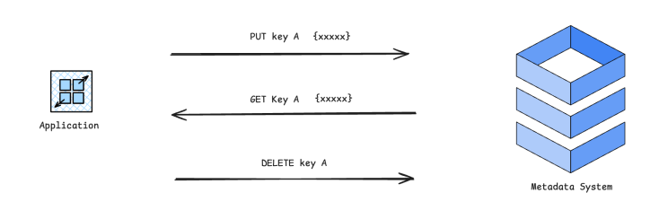

*Basic key-value operations define the primary mutation and lookup interface.*

The primary interface of a metadata system is usually key-value-based. Clients create, update, read, and delete metadata records by key. This keeps the core data model simple and makes it easy to reason about ownership and mutation ordering.

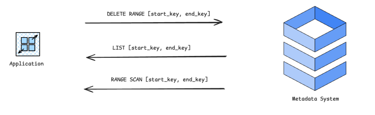

*Range operations expose the ordered structure of the keyspace.*

Many metadata keys also have an implicit order or hierarchy. For example, keys may be grouped by tenant, namespace, table, partition, or object prefix. Range operations make that structure usable: clients can list records under a prefix, scan a contiguous key range, or delete a range as one logical operation.

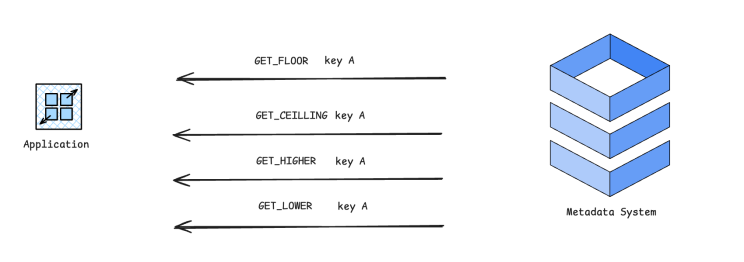

*Ordered-key lookups provide efficient navigation around a target key.*

Ordered-key operations such as floor, ceiling, higher, and lower allow clients to navigate neighbouring entries without scanning the full range. This is useful when the key order carries meaning, such as partition boundaries, object prefixes, or registration order.

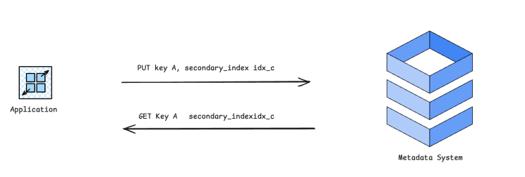

*Secondary indexes provide additional access paths over the same metadata state.*

Direct key lookup and range scans are still not enough for every query. Higher-level services often need to find metadata by secondary attributes, such as owner, status, type, lease, or placement. Secondary indexes provide those access paths, but they must be updated through the same mutation order as the primary record; otherwise, indexed queries can observe state that never existed consistently.

### Entry Versioning

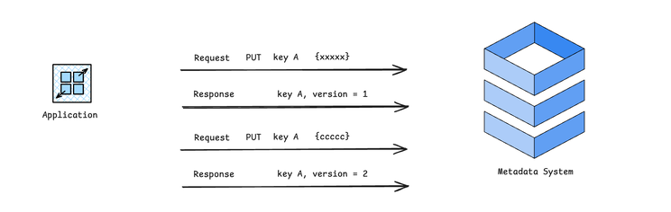

*Each successful mutation advances the version of the affected entry.*

Each metadata entry should carry a version that changes whenever the entry is successfully modified. The version gives clients a stable way to reason about whether the record they read is still current.

For example, the first successful PUT for key A may return version 1, and a later update returns version 2. The exact version format is an implementation detail; it can be a counter, revision number, or log position. The important requirement is that versions advance according to the same mutation order as the metadata state.

### Conditional Updates and Atomic Validation

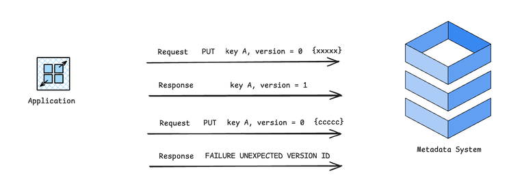

*Conditional updates apply only when the expected version matches the current entry version.*

Versioning becomes useful when it is combined with conditional updates. A client can submit a mutation with an expected version, and the server applies it only if the current version still matches.

This gives the system compare-and-set semantics. If two clients try to update the same entry based on the same old version, only one update should succeed. The other should fail without changing state. These checks must be evaluated inside the ordered apply path, not as a separate preflight check; otherwise, concurrent writes can both appear valid before either one is applied.

### Session/Lease-Based Ephemeral Entries

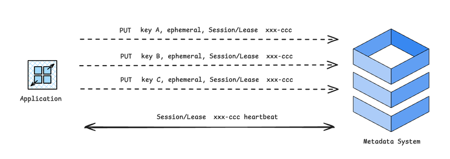

*Ephemeral entries are tied to a session or lease and are removed when that lease expires.*

Some metadata should exist only while a client, process, or service instance is alive. Examples include service registrations, ownership markers, locks, and temporary coordination records. These entries can be attached to a session or lease.

The client keeps the session alive by sending heartbeats or renewing the lease. If the lease expires, the server removes all ephemeral entries owned by that lease. Lease expiration should be handled as an ordered state transition, just like a normal delete, so recovery, indexing, and notifications observe a consistent sequence of changes.

### Durable and Ordered Notifications

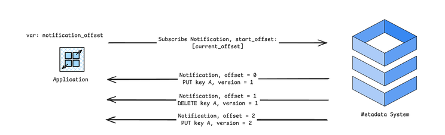

*Notifications expose applied mutations as an ordered stream with resumable offsets.*

Many consumers do not want to poll metadata repeatedly. They keep local caches, routing tables, scheduling views, or controller state derived from the metadata system. To keep those derived states fresh, they need to subscribe to changes and react when entries are created, updated, or deleted.

Notifications should be durable and ordered. Each notification should correspond to an applied mutation and carry an offset so clients can resume from a known point after disconnecting. The notification order should follow the same mutation order used by the metadata state; otherwise, a cache may apply events in an order that does not match the state it would read from the server.

This makes notifications more than a convenience API. They are the mechanism that lets clients maintain consistent local views without constantly polling the metadata server.

### Multi-Namespace Isolation

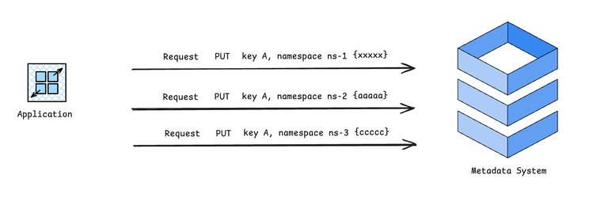

*Namespaces isolate metadata records that share the same logical key.*

A metadata server often serves multiple tenants, applications, or logical subsystems. Namespaces provide isolation by scoping keys, indexes, versions, leases, and notifications.

This means the same key can exist independently in different namespaces, and operations in one namespace should not affect another. Namespace isolation also gives the system a natural boundary for access control, quota management, listing, and future partitioning.

## From Interface to Implementation

Once the external interface and required functionality are defined, the implementation problem becomes more concrete: every accepted mutation must survive crashes, be applied in a deterministic order, and become visible to point lookups and indexed queries under the same consistency model.

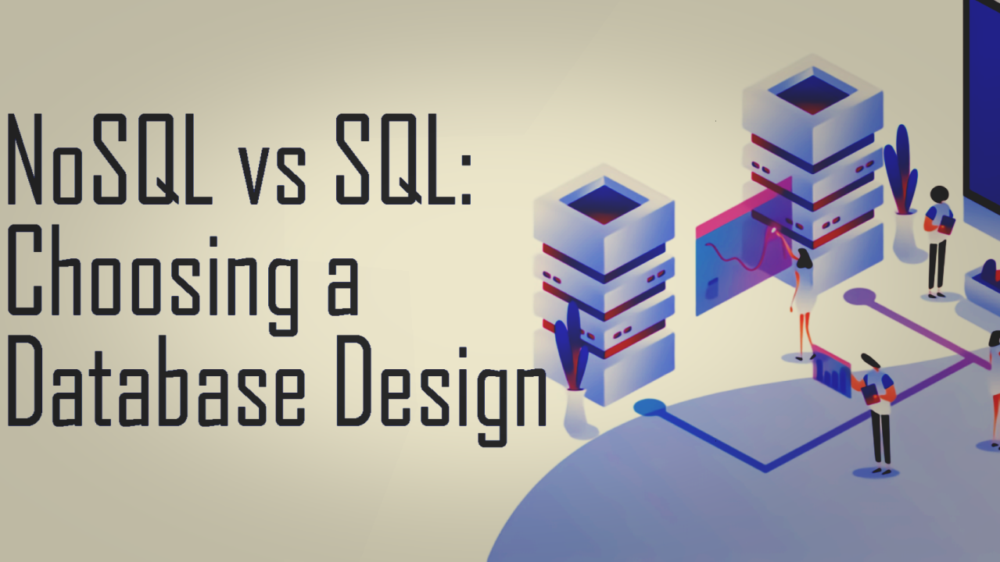

### Write-Ahead Log

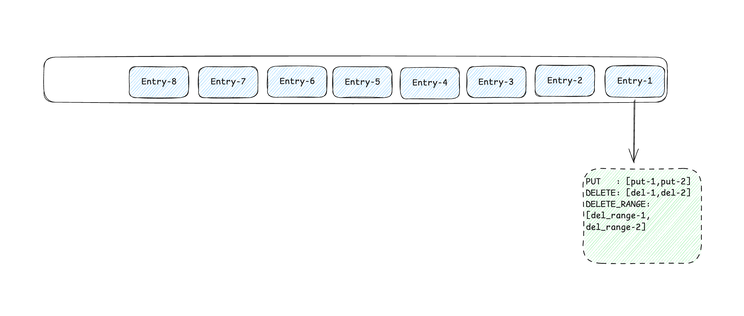

*Standalone logical WAL records mutations in the order they must be applied.*

In this design, the write-ahead log, or WAL, is the metadata server’s logical durability and ordering boundary. It is not just an internal storage-engine detail. Every state-changing operation, such as PUT, DELETE, or DELETE_RANGE, is encoded as a logical log record and appended to the WAL before the mutation is considered committed.

Each log record is assigned a monotonically increasing log position. This position defines the canonical order in which mutations are applied to the metadata state and derived indexes. Crash recovery does not need to infer what happened from a partially updated state; after restart, the server loads the latest durable state and replays WAL entries after the last applied position.

This ordering matters for metadata correctness. If a key is created, updated, and then deleted, recovery must replay those operations in the original order. The WAL gives the server a deterministic source of truth for rebuilding state after failure.

A production WAL also needs practical safeguards. Records usually include framing and checksums so recovery can detect partially written or corrupted entries. The server tracks the last applied log position so replay can be idempotent. Periodic checkpoints or snapshots are used to bound recovery time; once a snapshot includes all changes up to a given log position, older WAL segments can be compacted or removed.

This log-oriented design also prepares the system for distribution. In a standalone server, the WAL defines local durability and ordering. In a replicated system, the same concept becomes a replicated log, where consensus decides the committed order of mutations across nodes.

### Storage Engine

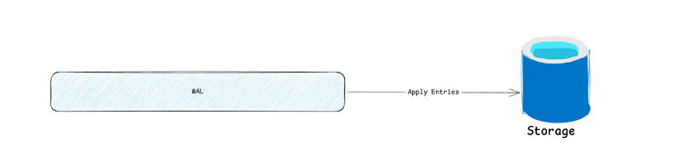

*The storage engine materialises the current metadata state from committed WAL entries.*

The storage layer should be treated as an implementation abstraction rather than a fixed product choice. An LSM-tree-based engine is often attractive for write-heavy metadata workloads because it turns many random updates into mostly sequential writes and relies on background compaction to reorganise data. The tradeoff is read amplification, write amplification during compaction, and more complex tuning around levels, memtables, and compaction pressure.

A B-tree-based engine can be a better fit when predictable read latency, ordered traversal, and range scans are more important. B-trees maintain data close to query order and can provide stable lookup behaviour, but random page updates may be more expensive, especially under heavy write concurrency.

From the metadata server’s perspective, the exact storage structure is less important than the contract it provides. The storage engine must support atomic updates to the primary state and indexes, expose consistent snapshots for reads and recovery, and allow the server to persist the last applied log position. As long as those guarantees hold, the underlying implementation can be LSM-tree-based, B-tree-based, or another durable ordered-key structure.

### Write Path

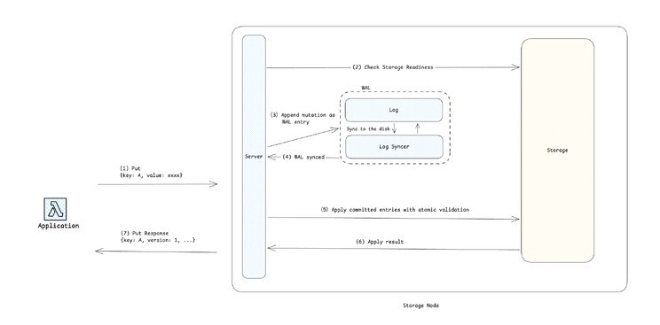

*Standalone write path: a mutation is appended to the WAL, synced for durability, and applied in log order before the client receives a result.*

The write path turns a client mutation into committed metadata state. Many clients may submit writes concurrently, but the server should not allow those mutations to change the logical state in an uncontrolled order.

When a write request arrives, the server first checks whether the node and storage layer are ready to accept mutations. This is not the same as checking an entry version. Readiness checks answer whether the server can process the request at all; version checks and other conditional validations are evaluated later when the mutation is applied.

If the request can proceed, the mutation is encoded as a logical command and appended to the WAL. The append gives the mutation a log position, which becomes its ordering point. Once the WAL entry satisfies the server’s durability policy, usually by being flushed or synced to disk, the entry becomes eligible for application.

The apply step processes committed entries in WAL order. During this step, the server performs atomic validation if the operation requires it, such as checking an expected version for a compare-and-set update. If validation succeeds, the mutation is applied to the primary key-value state and any derived indexes. If validation fails, the operation returns a failure status without changing the metadata state.

This design still allows concurrency at the edges of the system. Network handling, request parsing, readiness checks, WAL batching, read-only queries, and background maintenance can run concurrently. The critical constraint is narrower: logical state transitions must be applied according to the order defined by the WAL.

The client response is returned after the mutation has reached a durable log position and the apply result is known. This gives the write path a clear contract: accepted mutations are durable, ordered, and reflected in the materialised state before they become visible to the client.

### Read Path

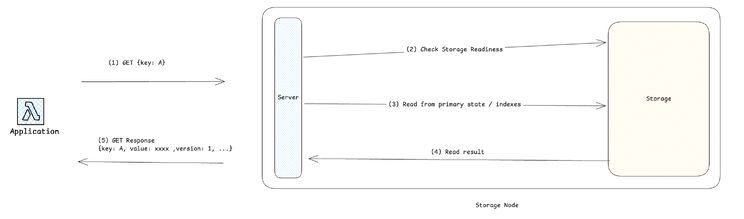

*Standalone read path: reads are served from the materialised state and observe a consistent applied prefix of the WAL.*

The read path serves queries from the materialised state, not by replaying the WAL. A point lookup reads from the primary key-value state. An indexed query first consults the relevant index to find candidate keys, then reads the corresponding metadata records from the primary state.

Unlike writes, reads do not create new log entries or define a new mutation order. However, they still need consistent visibility. A query should not observe an index entry without the corresponding primary record, or a primary record whose index update has not become visible.

A simple implementation may protect reads with shared locks around the current state. A more advanced implementation may use copy-on-write structures, MVCC, or immutable snapshots so reads can proceed concurrently with writes. Regardless of the mechanism, the read path should observe a state derived from a known applied prefix of the WAL.

This gives the system a clean correctness model: every committed mutation has a log position, writes are applied in that order, and reads observe a consistent state produced by applying a prefix of that ordered log.

### Recovery Path

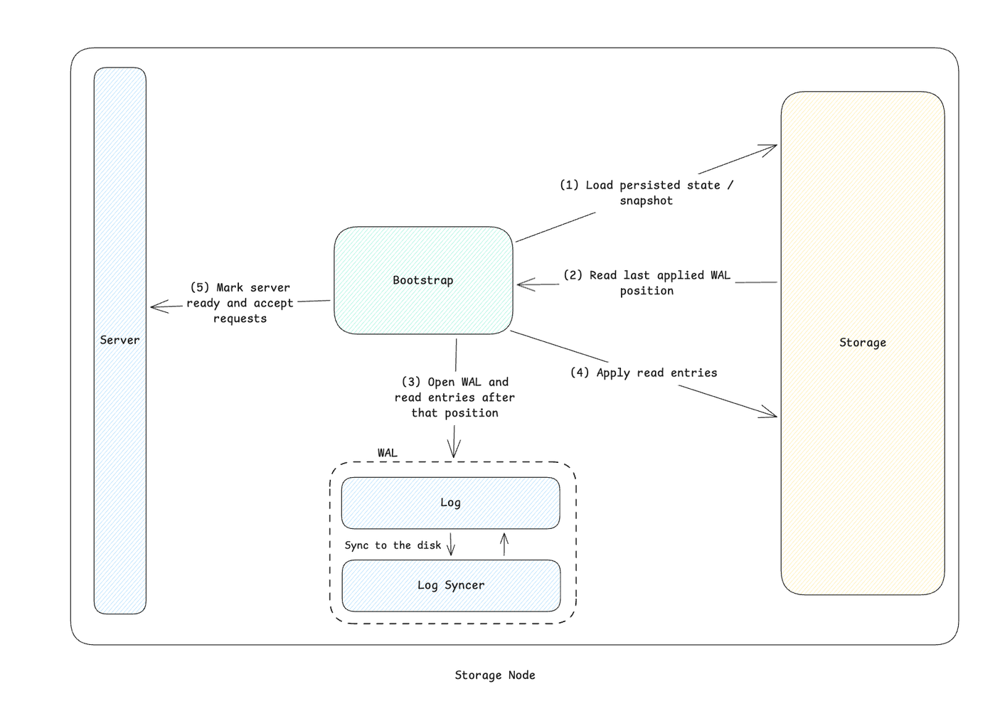

*Standalone recovery path: load the latest durable state, replay WAL entries after the last applied position, then mark the server ready.*

The recovery path is where the WAL and storage engine meet. After a restart, the server first loads the latest durable storage state or snapshot. That state includes, or is associated with, the last log position that has already been applied.

The server then opens the WAL from the next log position and replays any remaining records in order. Each replayed record goes through the same deterministic apply logic used by normal writes, including updates to the primary state and secondary indexes.

Recovery must be idempotent. If the server crashes while applying a log record, replaying the same record after restart should not produce a different result or apply the same logical mutation twice. Tracking the last applied log position allows the server to distinguish already-applied state from entries that still need replay.

Only after the replay reaches the end of the WAL should the server mark itself ready and start accepting new requests. At that point, storage again represents a state derived from a known prefix of the log, and new writes can be appended after the recovered log position.

This recovery model keeps failure handling simple: durable storage provides a checkpointed state, and the WAL provides the ordered suffix needed to bring that state up to date.

## Towards Distributed Replication

At this point, the standalone metadata server has a clear correctness model. Mutations enter through the write path, become durable and ordered in the WAL, are applied deterministically to storage and indexes, and become visible to readers through a consistent view. If the process crashes, recovery can rebuild the same state by loading the latest durable snapshot and replaying the remaining log entries.

This gives us a solid single-node foundation. The next challenge is making the same guarantees hold when the metadata system is no longer a single process on a single machine. With multiple replicas, the question changes from “how does one server order and persist mutations?” to “how do several servers agree on the same mutation order, survive failures, and expose a consistent state to clients?”

