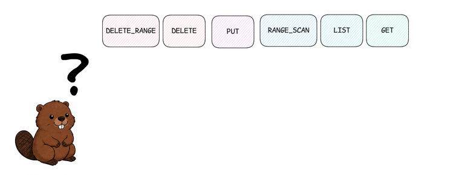
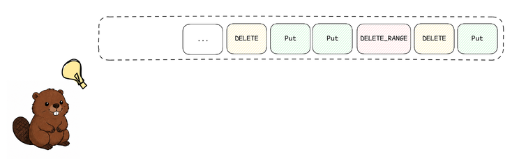
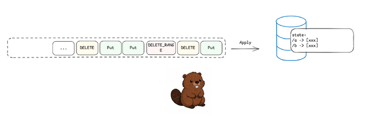
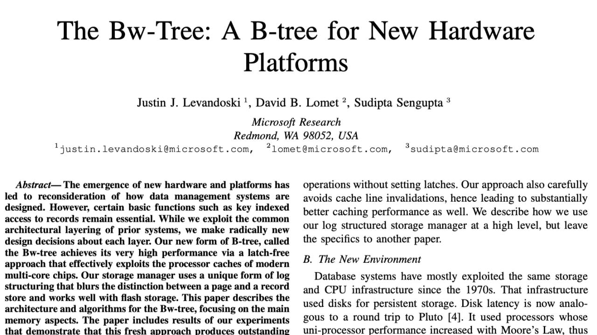
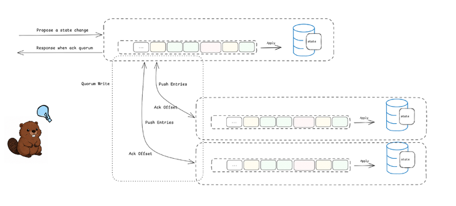
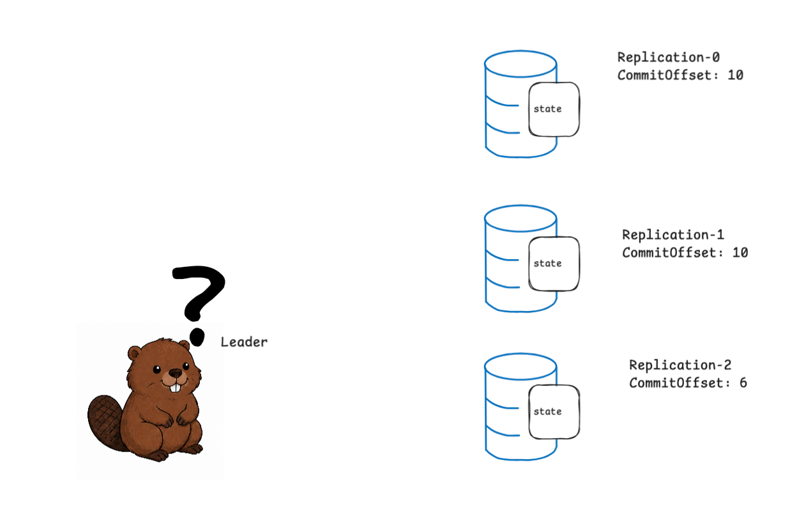
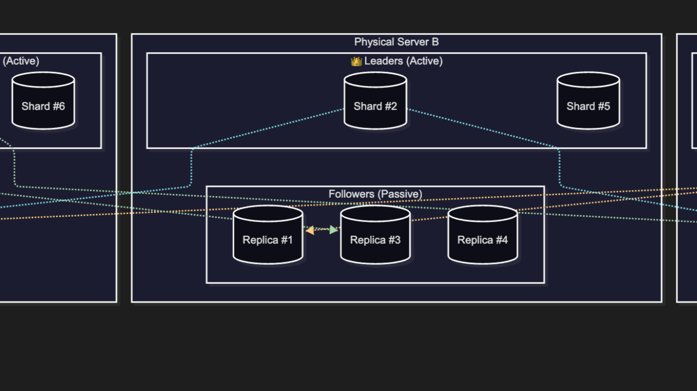

# Designing a Distributed Metadata System: From Local State to a Replicated State Machine

A local storage engine can recover from a process restart, but it still depends on a single machine. To tolerate machine failures, we need multiple independent replicas that preserve the same history.

In this article, we will evolve our standalone metadata store into a replicated metadata store. We will introduce mutations, the mutation log, a state machine, and leader-based replication. The result is a shared-nothing system in which every replica owns its local storage while applying the same committed mutations in the same order.

## Mutations



*Which operations are mutations?*

The metadata store maintains a collection of metadata records. It exposes a key-value abstraction: each key identifies a piece of metadata, while its value contains the corresponding record. For example, the store may contain user roles, topic configurations, and node status:

```
"/users/alice"   → { "role": "admin" }
"/topics/orders" → { "partitions": 16 }
"/nodes/node-7"  → { "status": "active" }
```

Clients can write or read a metadata record:

```
PUT "/topics/orders" VALUE { "partitions": 32 };

GET "/topics/orders";
```

We call an operation that changes the state a mutation. PUT, DELETE, and DELETE_RANGE are mutations; GET, LIST, and RANGE_SCAN are not.

Conceptually, a mutation transforms the current state into a new state:

```
State:
    "/topics/orders" → { "partitions": 16 }

Mutation:
    PUT "/topics/orders" VALUE { "partitions": 32 }

New State:
    "/topics/orders" → { "partitions": 32 }
```

Once state changes are represented this way, the system can persist their ordered history.

That history is the mutation log.

## Mutation Log



*Mutations are recorded in an ordered log.*

Mutations arrive over time. Instead of applying them directly to the metadata state, the system first records them in an ordered, append-only log.

```
Index    Mutation
─────    ────────────────────────────────────────────
0        PUT "/topics/orders" VALUE { "partitions": 16 }
1        PUT "/nodes/node-7"  VALUE { "status": "active" }
2        PUT "/topics/orders" VALUE { "partitions": 32 }
3        DELETE "/nodes/node-7"
```

Each mutation receives a monotonically increasing log index. The index identifies the mutation’s position in the log and its order relative to other mutations.

This order matters. For example, applying a PUT followed by a DELETE removes a record. Applying the same operations in the opposite order leaves the record in the store.

Once an entry has been appended, it is not modified. New mutations are added only at the end:

```
[0] [1] [2] [3] → [4]
```

Read-only operations such as GET, LIST, and RANGE_SCAN do not change state, so they do not need to appear in the mutation log.

For each write operation, the local write path becomes:

```
Mutation
   ↓
Durably append to the mutation log
   ↓
Apply to the metadata state
```

By recording mutations before applying them, the system preserves the information needed to reconstruct its state after a restart.

The mutation log is therefore more than a history of requests. It is the durable, ordered source from which the metadata state can be reconstructed.

The component that performs this reconstruction is the state machine.

## The State Machine



*The state machine applies mutations in order to construct the current state.*

The mutation log records what changed and in which order. To serve read operations such as GET, LIST, and RANGE_SCAN, the metadata store must apply those mutations to construct its current state.

The component responsible for this is the State Machine:

```
Mutation Log → State Machine → Metadata State
```

The state machine reads mutations from the log in order and applies them one at a time.

Using the earlier example:

```
Initial State:
    "/topics/orders" → { "partitions": 16 }

Mutation:
    PUT "/topics/orders" VALUE { "partitions": 32 }

New State:
    "/topics/orders" → { "partitions": 32 }
```

### Commit and Applied Offsets

Appending a mutation to the log and applying it to the metadata state are separate steps.

The commit offset identifies the latest mutation that has been durably accepted by the mutation log.

The applied offset identifies the latest mutation already reflected in the metadata state.

```
Mutation Log:

[0] [1] [2] [3] [4] [5]
         ↑           ↑
       Applied      Commit
       Offset       Offset
```

In this example:

- Entries 0–2 have already been applied.
- Entries 3–5 are committed but have not yet been applied.
- The state machine can apply entries 3, 4, and 5 in order.

The applied offset must never move beyond the commit offset. The state machine continues processing entries until both offsets are equal.

```
while appliedOffset < commitOffset:
    nextOffset = appliedOffset + 1
    mutation = log[nextOffset]
    apply(mutation)
    appliedOffset = nextOffset
```

In this standalone system, the commit offset advances after a mutation has been safely persisted in the local mutation log. When we introduce replication, commitment will require the mutation to be persisted by multiple replicas.

### Deterministic Application

Applying the same mutations in the same order must always produce the same state.

Values that could vary between executions—such as generated identifiers or timestamps—must be decided before the mutation is appended. The mutation should contain the final value that the state machine will apply.

This allows the metadata state to be reconstructed whenever the log is replayed.

### Recovery and Snapshots



```
Recover Local Storage
        ↓
Load Applied Offset
        ↓
Replay Remaining Committed Mutations
        ↓
Resume Serving Requests
```

If the local state is unavailable, or replaying the mutation log would be too expensive, the system can restore a snapshot. A snapshot contains:

- A point-in-time copy of the metadata state
- The applied offset represented by that state

After restoring the snapshot, the state machine applies the committed mutations that follow its applied offset.

The mutation log preserves the durable, ordered history. The state machine turns that history into metadata state, while local storage and snapshots make recovery efficient.

## The Replicated State Machine



*The leader replicates mutations to followers and commits them after receiving acknowledgments from a quorum.*

The mutation log and state machine allow the metadata store to recover from a process restart. They do not protect it from the loss or unavailability of the machine itself.

To remove this dependency, we run the metadata store on multiple independent replicas. Each replica maintains its own mutation log and metadata state:

```
Replica A: Mutation Log → State Machine → Metadata State
Replica B: Mutation Log → State Machine → Metadata State
Replica C: Mutation Log → State Machine → Metadata State
```

If all replicas apply the same committed mutations in the same order, they independently construct the same metadata state. Together, they form a replicated state machine.

### One Order Across Replicas

In the standalone system, the mutation log establishes a single order on one machine. With replication, every replica must agree on that same order. If replicas append mutations independently, their logs—and eventually their metadata states—may diverge. To establish one authoritative order, we assume that one replica has already been selected as the Leader. Clients send mutations to the leader, which assigns their log positions and replicates them to the remaining replicas, called Followers.

```
Client → Leader A
                 └──→ Follower B
                 └──→ Follower C
```

For now, we assume that a valid leader already exists. We will return to how leadership is assigned—and how stale leaders are prevented from writing—later in this article.

### Replicating a Mutation

When the Leader receives a mutation, it assigns the next log index and durably appends the mutation to its local log. It then sends the same log entry, including its index, to the followers:

```
Leader A:  [0] [1] [2] [3]
                       │
                       ├──→ Follower B
                       └──→ Follower C
```

In this example, the new mutation is assigned index 3. Each follower that receives the entry persists it at the same index and sends an acknowledgment to the leader.

The replicated write path is:

```
Receive mutation
        ↓
Append to the leader’s local log
        ↓
Replicate the log entry to followers
        ↓
Wait until a quorum has persisted the entry
        ↓
Advance the commit offset
        ↓
Apply the committed mutation on the leader
        ↓
Respond to the client
```

This is the normal replication path when followers already have the earlier log entries. A lagging follower can catch up by receiving its missing entries. If a replica has no usable local state—or if the required entries have already been compacted—it first restores a snapshot containing the metadata state and its applied offset, then receives the log entries that follow that offset.

### Committing with a Quorum

A mutation becomes committed after it has been durably stored by a quorum of replicas. In this design, a quorum is a majority of the replica set. In a three-replica system, the quorum is two:

```
Leader A:   persisted
Follower B: persisted
Follower C: unavailable

Result: 2 of 3 replicas → committed
```

The leader counts as one member of the quorum. Therefore, the system can continue committing mutations while one of its three replicas is unavailable.

After an entry reaches a quorum, the leader advances its commit offset:

```
Leader A:

[0] [1] [2] [3] [4]
         ↑       ↑
       Commit  Log End
       Offset
```

Entries 0–2 are committed. Entries 3–4 exist in the leader’s log but have not yet reached a quorum, so they must not be applied.

Replicas may temporarily have different log lengths and may not yet know the same commit offset:

```
Replica A: [0] [1] [2] [3] [4]   Known Commit: 2
Replica B: [0] [1] [2] [3]       Known Commit: 2
Replica C: [0] [1]               Known Commit: 1
```

Replica A and Replica B may apply entry 2. Replica C must first receive entry 2 before it can advance its applied offset.

A lagging follower can catch up by receiving the missing log entries or, if those entries have been compacted, by restoring a snapshot.

### One Committed History

Under our assumption that exactly one valid leader exists, the replicated state machine provides its central guarantee:

All replicas apply the same committed mutations in the same order.

Replicas may apply those mutations at different times. Once they reach the same applied offset, however, they produce the same metadata state.

## Leadership as an Assumption



*For now, we assume the coordinator has already selected the leader.*

The replicated state machine requires one leader to establish the order of mutations. In our architecture, leadership is assigned by an external Coordinator. This separates the system into two parts:

- The Control Plane assigns leadership and manages replica membership.
- The Data Plane replicates mutations, commits them through a quorum, and applies them through the state machines.

For this article, we assume that the coordinator has already selected one valid leader and informed the replicas of that decision. A valid leader must preserve the committed history, and only that leader may order new mutations.

```
Coordinator
↓ Assigns One Leader
↓ Leader → Followers
↓ Mutation Replication
```

Consensus protocols such as Raft combine leader election and log replication within one protocol. Our architecture separates these responsibilities between the coordinator and the replicas. Under this assumption, we treat the coordinator as an external control-plane component and focus only on replication under an already selected leader. Both the motivation for this separation and the mechanisms used to select leaders, handle failures, and prevent stale leaders from writing are outside the scope of this article. We will introduce them together with the sharded architecture in the next article, where the coordinator’s role becomes clearer.

### A Shared-Nothing Metadata Store

We started with a standalone metadata store backed by a local mutation log and state machine. By replicating that log, we now have multiple independent replicas preserving the same committed history.

Each replica maintains its own mutation log and metadata state. The replicas communicate only through the network and do not share memory or storage.

A mutation becomes committed after it has been durably persisted by a quorum. Each replica applies the same committed mutations in the same order and converges on the same metadata state.

The result is an etcd-like, shared-nothing metadata store. It resembles etcd at the architectural level, although its leadership model differs: etcd uses Raft, while our design assumes that leadership is assigned by an external coordinator.

For now, every replica stores the complete metadata state. Replication gives us fault tolerance, but it does not partition the data or increase write throughput.


